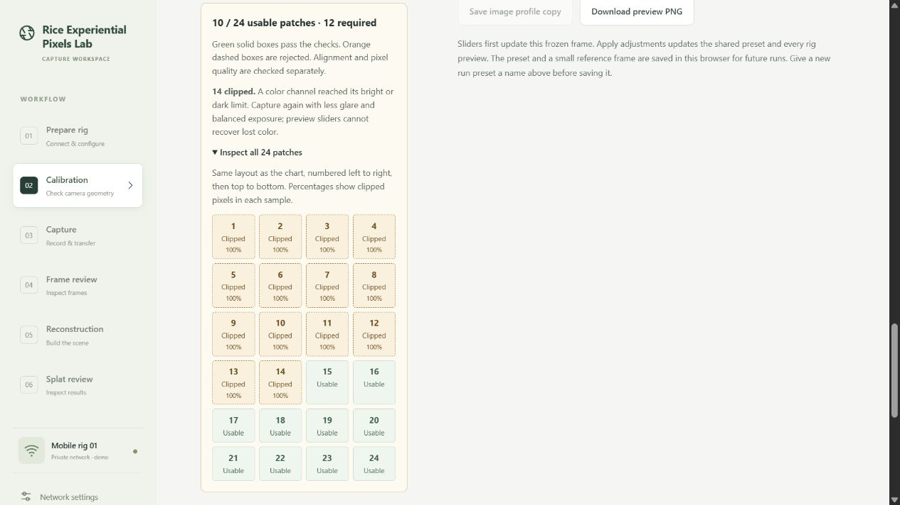
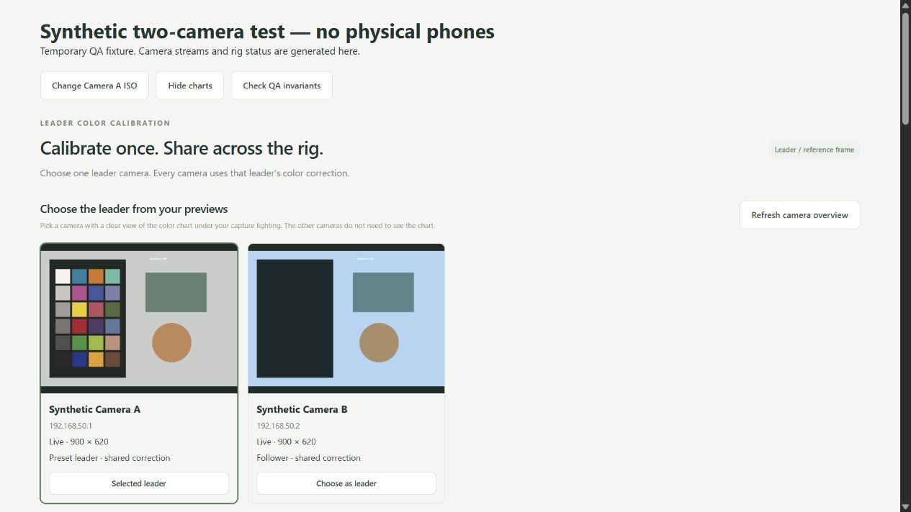

# Leader color calibration

Open `http://127.0.0.1:4317/calibration`. Color calibration computes corrections from actual camera frames or uploaded photos. The phone white balance control sends CameraScope commands. The chart fit creates a separate browser preview preset. Geometry acquisition and solving are not connected yet.

## Sync white balance on the phones

1. In **Prepare rig**, select the phones for the run. New phones follow their configured selection default. Start wireless previews for the angles you want to inspect. Followers can receive settings without streaming.
2. Open **Calibration**. Place the physical mat at the subject position in capture lighting. Choose a **White balance leader** with a clear, evenly lit view. Keep CameraScope open on that phone.
3. Select **Sync white balance to phones**. CameraScope runs `autoColorSnapshot` on the leader, waits for automatic white balance to converge and lock, then fixes its measured gains and sensor transform. The server sends that full color-processing snapshot to each selected follower using `setColorProcessing` over UDP 5010. This also copies the leader's tone mapping and processing modes. ISO and exposure are separate Prepare rig settings.
4. Inspect **Last sync**. Each match requires a separate `getState` readback of the requested settings. An offline phone or mismatched field is listed individually. If the leader fails, followers receive no writes. **Retry with same settings** reuses the verified leader snapshot on the current selection and skips phones already matching. Run a new sync when the lighting changes.
5. Select the chart model that matches your mat. Use **Check chart in this view** on each live camera tile. Keep the mat at the subject position and turn it toward the phone being checked if needed. Each check detects the chart again in that phone's original frame and samples through its own four-corner perspective transform. No phone settings or preview presets change during a check.

The check reports the median red/green and blue/green deviations from the chart reference across usable neutral patches in linear RGB. For example, red/green +20% means the gray patches look redder relative to green than the reference. Zero is the reference ratio. The check requires two neutral patches, excludes clipped or uneven samples and does not assign a pass threshold. Blurred, obscured or strongly angled views can fail detection. To inspect those manually, load that camera's chart photo and mark its four corner patch centers under **Manual alignment**. Readings also appear in the patch checks.

Identical requested settings can yield different colors under glare, different lighting, or different sensors and lenses. Check a fresh processed capture as well as the preview. The chart's fitted sRGB matrix is only used for previews. CameraScope supplies the sensor-space matrix. Automatic white balance evaluates the leader's scene; it does not fit the mat's individual patches. RAW sensor pixels do not have the preview correction baked in.

## Calibrate one leader, share across the rig

1. Start the desired wireless previews in Prepare rig. In Color calibration, refresh the overview and click **Choose as leader** on the camera with the clearest chart view. No first camera is silently made leader. The overview shows four streams at a time, with paging for a larger rig.
2. Choose the matching chart and enter a **Run / lighting preset name**. Only the leader needs to see the chart.
3. Press **Capture chart for shared previews**. The app captures a fresh original video frame, detects and samples the chart, fits a matrix, and saves a shared preset. Successful application means every Calibration preview uses the **same matrix and manual adjustments**, including followers that cannot see the chart. Detection/fit/storage failures do not replace an existing preset.
4. Compare the frozen leader frame before/after. Adjust strength, exposure, warmth, tint and saturation, then choose **Apply to all previews**. Sliders preview changes before applying them. **Show original** bypasses correction in the selected live view; **Disable shared correction** disables it across the overview without deleting presets.
5. The current shared preset is restored after reload. **Load preset & frame** restores its saved reference frame and adjustments for further editing, even without reconnecting the leader. **Save as new run preset** preserves a separate named copy. Reconnect the leader and capture again for a new automatic measurement.

This is the requested convenience mode: the leader is calibrated against the chart's known colors, and its correction is copied universally. Followers are not separately measured or matched to the leader. Stable lighting and similar cameras make this assumption more useful, but camera/lens/rendering differences remain. Keep camera processing fixed and inspect all views. Per-camera calibration can be added later.

The saved chart preset applies to **browser previews in the Calibration tab**. Run presets are reusable local presets, not yet attachments to real backend capture jobs. The original capture pipeline remains unchanged.

## Choose the reference chart

**Calibrite ColorChecker Classic** is the default chart: 24 patches in 6 columns × 4 rows, with dark skin at top left and the white-to-black neutral row at the bottom. Spyder Checkr 24 remains an alternative. Choose **Custom chart · import reference** or open **Chart layout & custom reference** to upload a custom JSON reference. The downloadable template follows the selected chart's dimensions; replace its example values with the actual target's verified values. Printing the template does not create a calibrated target.

All new calibrations use the standard 3 × 3 color correction matrix. Before/after comparison, manual alignment, adjustments and saving operate on the actual source image. There is no sample image generator in the website.

## Capture from a camera (no upload required)

Choose a reference source:

- **Rig camera:** start that phone's wireless preview in Prepare rig. Refresh cameras in Color calibration, select a real camera from the backend inventory, and connect its preview. This reuses the existing receive-only MediaMTX/WHEP player; it does not start or reconfigure phones. Only fresh, responding, preview-ready cameras appear. Capture rechecks the selected source against the backend.
- **This device's camera:** connect a USB/web camera or use the device browser camera. Permission is requested only on Connect; audio is always disabled. Browser camera access requires localhost or HTTPS (ordinary private-LAN HTTP is not sufficient). Browser/device compatibility varies.

For a rig leader press **Capture chart for shared previews**. For a local device test press **Capture & calibrate**. The browser waits for a new decoded video frame, freezes it, detects the chart and computes its correction. Before and after are two treatments of **the same frame**. It does not take two separate exposures or command a full-resolution phone still. Rig previews receive continuous local correction after successful leader calibration; local-device/upload work remains an image-only comparison and cannot silently become the rig's shared preset. Capture frames share the 1000 × 750 maximum preview size with uploads. A stalled/disconnected source fails instead of silently reusing an old frame.

The current image remains visible if detection fails, with retry/manual guidance. Changing leader clears the working reference but leaves an existing shared preset intact until a replacement succeeds. Disconnect releases the selected camera; leaving the Color tab or closing the page also releases overview streams and render callbacks. Delayed permission responses cannot reopen a closed camera. Calibration freezes only its reference image; the source video can keep playing while adjustments are edited.

## Use an uploaded chart photo

- Choose the exact matching chart model, or import its verified reference data.
- Load a JPEG, PNG or WebP under 20 MB. Convert RAW/HEIC with a consistent processing pipeline first. The browser decodes into an sRGB canvas; sampling and preview use a copy resized to at most 1000 × 750 pixels. Original files are unchanged.
- Select **Upload a photo**, then **Auto-calibrate**. No corner clicks are required when detection succeeds. The detector resolves the chart's orientation from the reference pattern.
- Use uniform illumination without reflections. Keep the camera's exposure, white balance and image processing fixed between reference and subsequent captures. In leader mode, only the selected leader needs to see the chart.
- Use **Manual alignment** if needed: rotate the photo to match the reference grid, click the **centers** of the top-left, top-right, bottom-right and bottom-left corner patches, then **Calibrate from points**. Arrow keys move the crosshair; Enter selects a point. For the default Classic reference, these are dark skin, bluish green, black and white. Follow the labels for the selected chart. Changing the reference, photo, orientation or corners invalidates the previous fit.
- Patch quality is shown even if the solve fails. Green solid sampling boxes pass; orange dashed boxes fail. The checks below the alignment image report usable counts, rejection reasons, and individual patches in chart order. Clipping shows the percentage of sampled pixels with any RGB channel at or below 2 or at or above 253; more than 10% excludes that patch. Unevenness, insufficient size and image bounds have separate guidance. Correct corner alignment does not guarantee usable color measurements, and the minimum of 12 remains enforced. Preview sliders cannot recover clipped source pixels.
- Product listing images and screenshots can exercise the workflow but do not measure your camera's response. Capture the physical chart with the selected leader under the rig's actual lighting for a meaningful preset.

Custom JSON: `name`, `colorSpace: "sRGB"`, integer `columns` and `rows` (2–12 each; at least 12 total patches), `patches` (row-major RGB triplets, each channel 0–255), and `source`. Lab and raw sensor values cannot be supplied as sRGB. Nonuniform layouts need a different sampling model.

## Calculation and limitations

`public/js/color-chart-detection.js` detects connected, near-uniform patch regions at up to 480 pixels on the long edge, proposes regular grids, refines projective geometry, and validates patch/color agreement. It checks rotation, patch coverage, a plausible matrix and held-out patch residuals; ambiguous multiple candidates fail. The detector runs in a module Web Worker with a timeout. It supports clear separated rectangular patch grids, not arbitrary target designs. Strong perspective, small charts, blur, shadows, missing patches and glare can fail. Automatic detection is a heuristic tested on synthetic fixtures, not yet validated against the lab's chosen physical chart.

`public/js/color-calibration.js` is pure, dependency-free image math. A projective transform maps the four corner patch centers to a regular grid. Each patch samples a 7 × 7 grid over its central area. Samples outside the image, too small, transparent, clipped, or with excessive variance are excluded. At least 12 usable patches and independent RGB information are required. These are prototype heuristics, not certified acceptance thresholds; smooth glare, wrong chart identity and illumination errors cannot all be detected automatically.

The fit minimizes squared error in **linear sRGB** using Householder QR on the original sample system. Every new fit is a 3 × 3 CCM (`output = M × RGB`), with output-channel rows and no additive offset. The matrix corrects global color balance and exposure gain. Matrix coefficients are bounded to ±8 as a prototype safeguard.

Validation predicts each accepted patch using a fit that excludes that patch. Rank-deficient or excessive withheld fits report unavailable validation and cannot replace the shared rig preset. This check validates the standard matrix; it does not select between correction models.

Before/after training error is per-channel RGB RMSE in encoded 8-bit sRGB on the *same accepted training patches*, after output gamut clipping. The separate **Withheld-patch RGB error** uses leave-one-patch-out predictions; it is not Delta E or an independent-photo test. Leader saving requires both training and withheld errors ≤12 and withheld error no worse than the uncorrected chart by more than 0.5; legacy presets without validation metadata remain readable. These checks are prototype heuristics, not certified accuracy limits. Test on a separate chart photo and representative scene before treating a profile as useful.

Inverse sRGB decoding removes display encoding; it does not recover raw sensor values. A CCM corrects global linear mixing, but cannot generally reverse nonlinear tone mapping, local edits, clipping, or mixed illumination. Use an unfiltered frame of a matching physical chart with consistent capture processing.

Manual correction order: the matrix transform is blended with identity by strength, followed by exposure, relative RGB warmth/tint gains, and saturation about linear luminance. Warmth/tint are relative adjustments, not Kelvin or measured white balance. Output is clipped to sRGB for display. The comparison, PNG export, selected live view and follower previews all use the same calculation. New profiles record the standard model, matrix, validation and manual adjustments. Older presets retain any saved offset for compatibility; recalibrating creates a standard matrix without an offset.

Method references: [Colour Science's correction discussion](https://github.com/colour-science/colour/discussions/747), [Colour's regression CCM documentation](https://colour.readthedocs.io/en/latest/generated/colour.characterisation.matrix_colour_correction_Cheung2004.html), and [OpenCV's CCM workflow](https://docs.opencv.org/4.x/d1/dc1/tutorial_ccm_color_correction_model.html). This app implements the matrix workflow locally in JavaScript, so camera-frame previews do not require a Python service or upload.

Classic reference: Calibrite identifies its [ColorChecker Classic](https://calibrite.com/us/product/colorchecker-classic/) as the replacement for X-Rite's Classic. The default uses the post-November-2014 X-Rite Lab values reproduced in [Colour's reference dataset](https://github.com/colour-science/colour/blob/develop/colour/characterisation/datasets/colour_checkers/chromaticity_coordinates.py), `DATA_COLORCHECKER24_AFTER_NOV2014_CIE_LAB`. Conversion: Lab to XYZ with ICC D50 white `[0.9642, 1, 0.8249]`; Bradford adaptation to D65 (`x=0.3127, y=0.3290`); standard D65 XYZ to linear sRGB; sRGB encoding, gamut clipping and rounding to 8-bit triplets. The cyan reference lies outside sRGB and its red channel is clipped to zero. These are nominal image-space targets, not measurements of an individual physical chart. Chart-specific measurements can be imported as custom sRGB JSON. [X-Rite's revision guidance](https://www.xrite.com/service-support/new_color_specifications_for_colorchecker_sg_and_classic_charts) distinguishes the older reference data.

Spyder reference: [Datacolor V2 patch data](https://www.datacolor.com/spyder/downloads/SpyderCheckr_Color_Data_V2.pdf), columns E–H, rows 1–6, transcribed from the sRGB table. In that PDF the Blueprint row label is mistyped as 4G; the grid identifies it as 2G. Its RGB values are 58, 88, 159. Exact chart variants/production revisions still need confirmation against the lab's physical target.

## Persistence and backend boundary

`public/js/color-workbench.js` owns the working image and UI. `color-profiles.js` persists up to 12 named leader presets plus an active ID under `splat-color-leader-presets-v1` in localStorage. Each preset contains the matrix, adjustments, chart, immutable leader identity/settings, source metadata, fit results, and a JPEG reference frame resized to at most 640 × 480. Applying manual adjustments updates the edited preset; saving as a new run creates a separate ID. Storage failure is surfaced before reporting a successful application. JSON exports include the reference frame. These presets remain local to this browser/origin and are not synced to the rig server. Unsaved edits are lost on reload.

Legacy image-only snapshots from actual camera frames or uploads remain separate under `splat-color-profiles-v1`, with up to 20 copies. They are never automatically promoted to shared presets. Old synthetic snapshots are excluded from the preset list.

`color-camera-overview.js` presents real inventory/streams, explicit leader selection, and leader/follower labels. `color-live-preview.js` renders the same correction on every displayed follower and the selected rig view, at up to roughly six frames per second and 480 × 360 pixels. It always reads the original video, never a corrected canvas. New calibration frames therefore cannot double-apply an existing correction. Original/corrected switching, stale/unavailable video and cleanup retain the unmodified source stream.

Status is checked every five seconds. Shared presets require the same rig backend and saved leader identity. Reported changes to the leader's lens/exposure/color settings pause reuse until recalibration; stale or unavailable inventory also suspends rendering. A temporarily offline leader can leave a saved preset in use on responding followers. Followers intentionally do not need the same identity or reported settings as the leader. Changes in physical lighting, unreported settings and automatic processing drift cannot be detected reliably; the operator must reassess the preset.

Exports include camera/lens label, lighting/profile name, chart reference, source filename and preview dimensions, corners, detection metadata, matrix, fit statistics and manual adjustments. Camera captures also record source type, camera identity, capture time, video dimensions and available reported settings (not verified sensor measurements). Profiles marked `sample: true` are not available in the current interface. Every export declares `pipeline: "decoded-sRGB-image"` and `appliedToHardware: false`.

Do **not** send this image-space matrix directly to Android's sensor-space color transform. The phone sync uses CameraScope’s sensor snapshot and verifies its readback. Validate the chosen chart and a separate processed capture on the deployed rig before using a profile for final image processing. A live video preview and still/YUV capture must be checked for compatible color processing before sharing a profile.

## Verification

`test/color-calibration.test.js` verifies correction math and sampling. `test/color-chart-detection.test.js` covers rotation, perspective, noise, unknown positions and rejection of absent/wrong/ambiguous charts. `test/color-camera.test.js` covers source freshness, new-frame waiting, stall/abort failures, camera identities, permission rejection/races, and track/peer cleanup. `test/color-leader-presets.test.js` covers shared scope, follower independence, persistence, settings changes, rejection and storage errors. `test/color-live-preview.test.js` checks source pixels, toggling, cleanup and rendering failure.

Run `npm test` for the current suite. Regressions cover the Classic 6 × 4 layout under rotation, perspective and noise; custom reference import/detection; recovering a known color cast on independent scene colors; standard-only fitting; validation failures; and compatibility with existing saved presets. These are synthetic tests, not physical-chart accuracy measurements.

Synthetic sources below are test fixtures only; the website has no sample-photo controls.

Patch-diagnostic regression: uploading `docs/screenshots/synthetic-clipped-chart-qa.png` and marking the four corner centers reproduces 10 usable patches: the first 14 have a clipped red channel. The solve remains blocked, saving/application stays disabled, and all rejection reasons remain visible. This fixture tests rejection behavior only; it is not a reference chart or a reconstruction of the user's photo.

Browser QA uses two generated video streams and mocked rig/WHEP negotiation. One leader sees a chart; the follower does not. A single capture creates one shared preset, and pixels in both previews match that same transform. Checks also cover manual updates, preset copy/reload/reference-frame restoration, failed leader replacement and suspending both previews when the leader's reported ISO changes. This is synthetic video, not a physical phone or a deployed gateway test. Real chart/camera accuracy remains unvalidated until lab testing.

