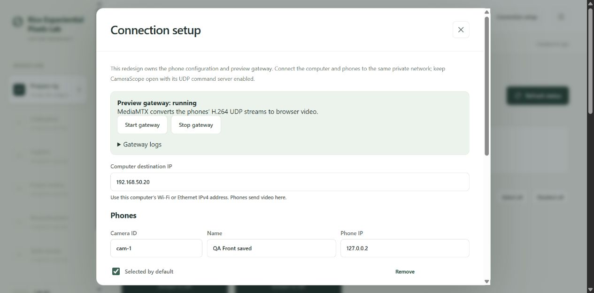
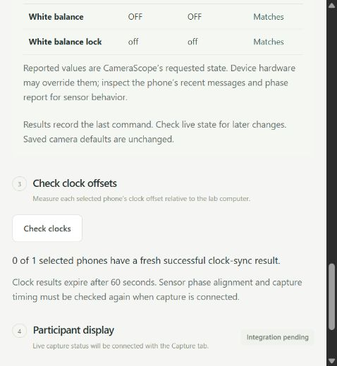

# Standalone CameraScope rig setup

The redesign owns the phone configuration, UDP commands and MediaMTX gateway.
**The old Multi-Phone-Splat webapp/server does not need to run.** CameraScope's
Android code and features are unchanged.

## Start the redesign

1. Check out `feature/frame-review` and install Node.js 20 or newer.
2. Stop the old webapp and its gateway so their ports are free.
3. Run `npm start` in the redesign folder. No npm packages need installing.
4. Open `http://127.0.0.1:4317/`, then **Connection setup**.
5. Enter or verify the phone IDs/names/IPs, selected-by-default flags, computer destination
   IPv4 address, and saved camera defaults. Save configuration.
6. Put the computer and phones on the same private Wi-Fi/LAN. Keep CameraScope
   open with its UDP command server enabled on port 5010.
7. With a saved phone inventory, the gateway starts automatically on server startup.
   After first-time setup, or if it is stopped, use **Start gateway** in Connection
   setup. Inspect its status/logs there.
8. Select the intended phones, click **Start selected previews**, and review the
   destination. A stopped phone camera pipeline will be started. Wait for each
   card's **Live** label, which confirms displayed video frames.

A fresh installation starts with **zero phones** and no computer destination IP.
Import your existing lab configuration or enter the actual addresses in Connection
setup. The app does not discover phones automatically. Existing saved configurations
are preserved; remove any unused entries manually. Only valid UDP replies count
as responding phones, and only advancing browser frames earn a Live label.

The Windows MediaMTX **v1.18.2** runtime and MIT license are included under
`tools/mediamtx/`. On Linux/macOS, install the corresponding runtime and set
`MEDIAMTX_EXECUTABLE` to its local path. See [runtime provenance](../tools/mediamtx/README.md).



## Import an existing lab configuration once

The repository does not contain the lab computer's ignored saved configuration.
If you have one, stop the redesign and run this **before its first startup**:

```powershell
npm run import-config -- "C:\path\to\Multi-Phone-Splat\.camerascope\webapp-config.json"
```

The importer copies phone IDs, serials, names, IPs, enabled flags, PC destination,
camera defaults, CLI installation paths and saved capture options. It validates
the result and leaves the old file untouched. To replace a local configuration
that has already been created, back up `.camerascope/rig-config.json`, then add
`--replace` to the command. Start the redesign afterward. This is a one-time
file migration; no old HTTP server is contacted.

## Saved configuration and clock CLI

Configuration persists in `.camerascope/rig-config.json`, excluded from Git.
Saving through Connection setup does not send commands to phones. Changing
phone routes restarts a running gateway; start selected previews again to update
their destinations. Invalid input leaves the saved file unchanged. A corrupt
file produces an explicit error instead of silently resetting the inventory.

Connection setup edits phone inventory, PC destination and saved ISO/exposure/
frame-rate/white-balance defaults. Applying settings in Prepare rig changes only
selected phones, with independent state readback; it does not overwrite saved
defaults. Edit those defaults in Connection setup when you want them retained.
Existing browser selection preferences take precedence over selected-by-default
flags; new cameras use the saved flag.

Clock checks need the **CameraScope Python CLI**, independently of the old
webapp. Set `cameraScopeRoot` to the directory containing `scripts/camerascope_cli.py`
and `pythonExecutable` to your Python installation in the local configuration.
The supplied CloneCameraScope repository nests this directory at
`CameraScope-main/CameraScope-main`. Alternatively use server environment settings:

```powershell
$env:CAMERASCOPE_ROOT = "C:\path\to\CloneCameraScope\CameraScope-main\CameraScope-main"
$env:CAMERASCOPE_PYTHON = "python"
npm start
```

Preview/status/settings commands use UDP directly and need neither Python nor
ADB. Executable paths are configured locally, not through browser inputs.

Optional server settings: `RIG_CONFIG_PATH` overrides the configuration file;
`MEDIAMTX_EXECUTABLE` overrides the gateway runtime; `RIG_GATEWAY_AUTOSTART=0`
disables automatic gateway startup. `RIG_BACKEND_URL` is no longer used.

## Wireless ports and gateway ownership

| Purpose | Port |
| --- | --- |
| CameraScope command listener on each phone | UDP 5010 |
| Phone H.264/RTP video to computer | UDP 5004, 5006, …, one route per inventory position |
| Phone metadata to computer | UDP 6004, 6006, … |
| MediaMTX browser/WHEP signaling | TCP 8889 |
| WebRTC ICE video transport | TCP/UDP 8189 |
| MediaMTX control API, loopback only | TCP 9997 |

The server generates `.camerascope/mediamtx.generated.yml` from its own inventory
and manages its own gateway child process. Start/stop controls never send phone
commands or adopt/terminate an old gateway. Occupied ports produce a conflict
message. Server shutdown stops its owned gateway. Stop selected streams disables
phone video output while retaining the phone camera pipeline.

For an operator on another private-LAN device, use
`npm start -- --host=0.0.0.0` and browse to `http://LAB-COMPUTER-IP:4317/`.
Video uses the same reachable computer hostname on port 8889. Allow the listed
ports on the private-network firewall. Use one operator on a trusted private
network; the development server has no login or TLS. Do not run commands from
another controller concurrently. There is no distributed lock with the old app.

## Status and limits

- Phone observations poll every five seconds and expire after 20 seconds.
  Gateway readiness, phone response, matching stream destination and actual
  browser frame progress are separate observations. A stale or mismatched phone
  route cannot display a supposedly identified live camera.
- **Live** requires displayed frames to advance. Stalls lose the green label and
  reconnect. **Retry** reconnects only the browser; **Enlarge** expands the card.
  The player is receive-only and needs no camera/microphone permission or public
  STUN service. WHEP sessions and peers are released on retry, disconnect and exit.
- Toggling streams/destinations can restart CameraScope's pipeline. Finish takes and
  recordings first. Selected phones reporting H.264 recording reject settings
  and stream mutations. Commands require acknowledgements and matching state;
  timeouts are not automatically retried because a command may have arrived.
- Clock checks use `sync-many --no-save`; offsets expire after 60 seconds and are
  cleared on disconnect, configuration changes, setting changes and stream changes.
  They do not set phone clocks or establish sensor phase/capture readiness.
- Manual settings readback verifies requested CameraScope state, not measured
  sensor exposure/color/timing. Phone-supported limits still need lab verification.
- Older CameraScope builds may omit `autoExposureEnabled` or white-balance
  reporting. If ISO, exposure and frame interval match, missing optional fields
  produce an amber **Settings partly verified** result, not a false mismatch.
  Missing core numeric values or reported differences still fail verification.
  Each settings result includes a requested/reported comparison; unreported
  fields are never counted as confirmed, and `requestedStateConfirmed` remains
  false for partial verification. The activity log retains the comparison.
  For example, a 29 FPS request corresponds to approximately 34.482759 ms.
  CameraScope may report that requested interval while its phase report and
  device-override messages show an actual interval near 33.333333 ms (30 FPS).
  Readback success does not override a hardware limit.
- Geometry calibration, capture, transfer, reconstruction and participant capture
  status remain integration work. Their screens do not simulate successful work.

The review dialog shows the requested values before submission. It does not simulate a photographic change. Prepare rig previews continue showing actual output. The [Color calibration screen](COLOR-CALIBRATION.md) lets the operator choose a leader from live previews, capture one chart frame, and share its correction across every preview in that Calibration screen. Named run presets retain the reference frame and manual adjustments locally. Applying that correction to phone settings, final capture files, or a phone-settings trial and restore still needs pipeline integration and verified CameraScope contracts.

The legacy-format mock below confirms matching numeric values while leaving the
missing auto-exposure flag explicitly unverified; it does not contact a phone.



- The running count uses CameraScope’s `isCapturing`, which means its camera pipeline is active, not that a research take is recording. A valid response alone does not count as running.
- Battery level and Wi-Fi strength are omitted; the available source does not establish those fields.
- Settings readback compares `iso`, `exposureMs`, `frameDurationMs`, `autoExposureEnabled` and `colorProcessing.awbMode`. These are **requested CameraScope state**, not measured sensor exposure, frame timing or image color. Manual settings explicitly disable auto exposure and clear the white balance lock; both states are checked in readback.
- A ready gateway route does not prove that the operator’s browser decoded a frame. The separate Live label requires displayed frame progress; negotiation errors, stalls and reconnects appear on the affected card. The view is receive-only and never requests camera/microphone access. There are no public STUN dependencies; the browser and gateway must be reachable on the lab LAN.
- The clock check measures offsets; it does not change phone clocks or persist the original capture cache (`--no-save`). It is not sensor phase alignment or capture readiness. Fresh offsets must be measured and used by the eventual capture preflight.
- Geometry calibration, synchronized capture, transfer, reconstruction, and the live participant cue still require integration. Color calibration at `/calibration` uses real video frames or uploaded photos and local image processing.
- Operation locks are local to this redesign process; it does not query the original app. Do not issue commands concurrently from both apps. Stop the redesign and its gateway before returning to the original capture application.
- Events and command acknowledgements are held in server memory and reset on restart. Reloading a browser does not restore a green status from local storage.

## Verification and lab acceptance

Automated checks cover persistent configuration, one-time import, invalid input,
gateway lifecycle/port conflicts, selected UDP commands, readback and WHEP/frame
state. The bundled MediaMTX runtime was also started/stopped locally and queried
through its real API. Browser QA used mock UDP phones without any old HTTP server.
Earlier browser checks decoded synthetic H.264 through the player. Physical
phones and the deployed wireless network still need these checks:

1. Keep the old server stopped. Import/verify configuration and start only the redesign.
2. Start previews for one selected phone. Confirm its identity and image, while
   deselected phones remain unchanged. Retry and enlarge the view.
3. Disconnect a phone or close CameraScope. Its response/live state must expire;
   restore it and verify recovery.
4. Apply a small supported setting change to one phone and inspect physical state
   and image. Verify readback and partial-failure handling.
5. Check clock results using the independently installed CLI; inspect per-phone reports.
6. Stop/restart the gateway. Confirm streams disappear/recover, then stop a selected
   phone stream and verify its camera pipeline stays active.
7. Save configuration, restart the redesign and confirm persistence. Editing
   inventory must not mislabel old video arriving on a changed route.
8. Check previews from the intended operator device and finish physical timing/
   image-quality checks before a research session.

Source contracts were checked against Multi-Phone-Splat `8060792` and
CloneCameraScope `1c17f73`. The installed Android revision still needs confirmation.
