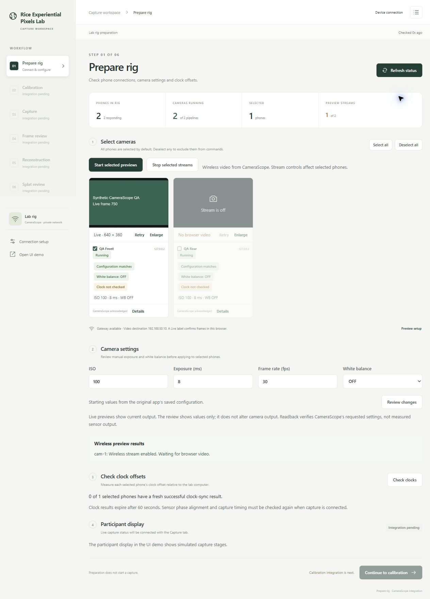

# Prepare rig: first hardware integration

## Run on the existing lab computer

1. In GitHub Desktop, pull the redesign branch and open its folder in a terminal.
2. In a **second terminal**, start the existing Multi-Phone-Splat app using its usual lab startup process. Its default address is `http://127.0.0.1:4173`. Keep it running.
3. In the original app, confirm the phone IP addresses, `cameraScopeRoot`, `pythonExecutable`, and PC destination IP. Keep CameraScope open on every phone. Use the existing private network.
4. Confirm the original server's MediaMTX gateway is running. That server starts the gateway at startup when its existing `tools/mediamtx/mediamtx.exe` runtime is installed. Its own Start gateway button also configures the entire phone fleet; use the redesign's selected-preview controls for phone commands.
5. In the redesign terminal run `npm start`. Open `http://127.0.0.1:4317/`.
6. Compare the inventory with the rig. Refresh status, select phones, then click **Start selected previews** and review the destination and selected names. Live frames appear in the camera cards. Review/apply settings and check clock offsets. Open **Details** on a phone or the activity log for recovery instructions and raw responses.

No package installation is needed for the redesign. The lab computer still needs the original CameraScope Python environment and MediaMTX installation. Both servers and the CLI must run on the **same computer**, because the adapter uses the original configuration’s filesystem paths.

If the original server uses a different port, set it before starting the redesign. Windows PowerShell:

```powershell
$env:RIG_BACKEND_URL = "http://127.0.0.1:4173"
npm start
```

macOS/Linux:

```sh
RIG_BACKEND_URL=http://127.0.0.1:4173 npm start
```

For a second operator device on the private LAN, start the redesign with `npm start -- --host=0.0.0.0` and browse to `http://LAB-COMPUTER-IP:4317/`. Preview frames use the same computer’s hostname on port 8889. MediaMTX WebRTC also requires port 8189 and the original per-camera UDP video ports. Keep the server on a trusted private LAN; it has no login system. Only one operator should control the rig.

## What is connected

| Control or indication | Evidence / action |
| --- | --- |
| Phone inventory | Original server `GET /api/config`; no invented phones or automatic network discovery |
| Responding | Valid CameraScope `getState` response over UDP 5010, including a state object |
| Start selected previews | UDP `set` with `udpHost`, route-specific `udpVideoPort`/`udpMetadataPort`, `streamEnabled:true`; add `capture:true` only for a stopped pipeline. Independent state readback must match. |
| Stop selected streams | UDP `set` with `streamEnabled:false`; never sends `capture:false`. Independent readback must confirm disabled streaming. |
| Gateway available | Original server `GET /api/gateway` reports the matching route/IP ready. This is separate from browser playback. |
| Live video | Receive-only WebRTC/WHEP player reports Live only while displayed frames advance; stalls warn and reconnect. Retry affects only this browser; Enlarge expands the card. |
| ISO / exposure / frame rate | UDP `set` with `autoExposureEnabled:false`; requires acknowledgement and matching `getState` readback |
| White balance mode | Included in UDP `set.colorProcessing`, followed by independent `getState` readback; compares the reported mode |
| Clock offset check | CameraScope CLI `sync-many --hosts … --count 30 --jobs … --no-save`; requires one successful result per selected IP |
| Errors | Server session log, affected phone, raw response/command report, and next checks |

Status is polled every five seconds. Readings older than 20 seconds are treated as stale. Clock checks expire after 60 seconds, and are cleared on disconnect, setting changes or stream changes. Phone identity and selection persist independently of observations. All new phones start selected; select-all/deselect-all and individual selections affect settings, clocks and stream commands. The server rejects empty, duplicate and unknown selections.

Stream controls reuse CameraScope's existing Android functionality. They do not edit its code, camera selection, exposure/color settings or the original app's saved configuration. Toggling a stream or its destination can restart the CameraScope pipeline; finish any take/recording first. The adapter refuses mutations while the original workflow is running/unknown or a selected phone reports H.264 recording. Stop disables video output while retaining the camera pipeline. A successful start readback confirms requested streaming state, while actual browser frames have a separate Live indicator. Preview commands need no Python or ADB.

Applying settings changes the phones; it **does not edit the original app’s saved capture configuration**. That app may reapply its own configuration on the next capture. Reconcile settings there before capturing. The supported ranges are input bounds, not a guarantee that every phone supports them; rejected/clamped values require inspection in CameraScope.

The review dialog shows the requested values before submission. It does not simulate a photographic change. Live previews continue showing actual output. A true before/after image trial and restore needs verified CameraScope state/capture contracts and is not implemented here.

## Observations that are deliberately not inferred

- The running count uses CameraScope’s `isCapturing`, which means its camera pipeline is active, not that a research take is recording. A valid response alone does not count as running.
- Battery level and Wi-Fi strength are omitted; the available source does not establish those fields.
- Settings readback compares `iso`, `exposureMs`, `frameDurationMs`, `autoExposureEnabled` and `colorProcessing.awbMode`. These are **requested CameraScope state**, not measured sensor exposure, frame timing or image color. Manual settings explicitly disable auto exposure and clear the white balance lock; both states are checked in readback.
- A ready gateway route does not prove that the operator’s browser decoded a frame. The separate Live label requires displayed frame progress; negotiation errors, stalls and reconnects appear on the affected card. The view is receive-only and never requests camera/microphone access. There are no public STUN dependencies; the browser and gateway must be reachable on the lab LAN.
- The clock check measures offsets; it does not change phone clocks or persist the original capture cache (`--no-save`). It is not sensor phase alignment or capture readiness. Fresh offsets must be measured and used by the eventual capture preflight.
- Calibration, capture, transfer, reconstruction, and the live participant cue are disabled in the real interface. The previous design remains at `/?demo=1`, where all those operations are simulated.
- Operation locks are local to this redesign process. It checks the original `/api/job` status before mutations, but cannot prevent another operator from starting work in the original app afterward. Do not issue commands concurrently from both apps.
- Events and command acknowledgements are held in server memory and reset on restart. Reloading a browser does not restore a green status from local storage.

## Source and compatibility

The initial adapter followed the reviewed [Multi-Phone-Splat source](https://github.com/rice-exp-lab/Multi-Phone-Splat) at `85ad82f41d2dcfd2187cd974993c6737b99aaf49`. The wireless preview extension also checked its current `main` at `8060792c88aacde00488910d80b69367d695b3f1`:

- `server.js`: `/api/config`, `/api/gateway`, `/api/job`, `routeFor`, and MediaMTX port/route conventions.
- `lib/camerascope-color.js`: `getState`, `setColorProcessing`, white balance mode values, `response.state.colorProcessing`.
- `lib/camerascope-capture.js`: `set` and `sync-many` CLI arguments and per-host sync results.

The supplied [rice-exp/CloneCameraScope](https://github.com/rice-exp/CloneCameraScope) was reviewed at `1c17f73b0fe766caa6d24c6f3db86c528fe1522f`. Its sources are nested under `CameraScope-main/CameraScope-main/`. `app/src/main/java/com/explab/camera/ui/CameraScopeViewModel.kt` establishes the exact requested-state fields and `set` command; `scripts/camerascope_cli.py` establishes the clock sampling/report contract. Set `cameraScopeRoot` to the directory containing **scripts**, not necessarily the repository root. The version installed on the phones still needs lab confirmation.

The player uses the [official MediaMTX WHEP endpoint](https://mediamtx.org/docs/read/webrtc) and browser `RTCPeerConnection`. It gathers ICE before the SDP POST, observes frame progress, and closes peers and WHEP sessions on disconnect, retry or page exit. No packages or new gateway installation are added to the redesign.

## Lab acceptance checks

Automated tests exercise mocked backend/CLI/WHEP responses and real loopback UDP. Browser QA also negotiated and decoded a synthetic H.264 WebRTC loopback stream; it did not use a physical phone or the deployed MediaMTX runtime. Before a research session:



1. Start with one selected phone. Confirm its IP and preview against the physical device.
2. Close CameraScope or disconnect Wi-Fi. The card must lose response status on the next poll; no green state should survive a stale/disconnected server.
3. Select only one phone, apply a small supported ISO/exposure/white-balance change, and inspect CameraScope and the live image. Confirm deselected phones were unchanged.
4. Repeat with one unavailable phone. Verify per-phone failure and recovery details; a successful phone should not hide another phone’s failure.
5. Synchronize selected phones and inspect the per-IP report. Verify missing results are failures and that the UI expires the result. Do not use this as a sensor-timing acceptance test.
6. Stop MediaMTX and verify previews become unavailable. Check preview playback from the intended operator browser/device.
   Start selected previews for one phone and confirm every deselected phone is unchanged. Verify the card reaches Live. Use Retry and Enlarge. Stop selected streams and confirm streaming is off while the phone camera pipeline remains active. Briefly interrupt Wi-Fi and confirm the view loses Live status and reconnects when restored.
7. Start a workflow in the original app. Rig mutations here must be disabled/rejected. End it before resuming.
8. Reconcile the original capture settings, then use the existing app for actual capture until later tabs are integrated.
